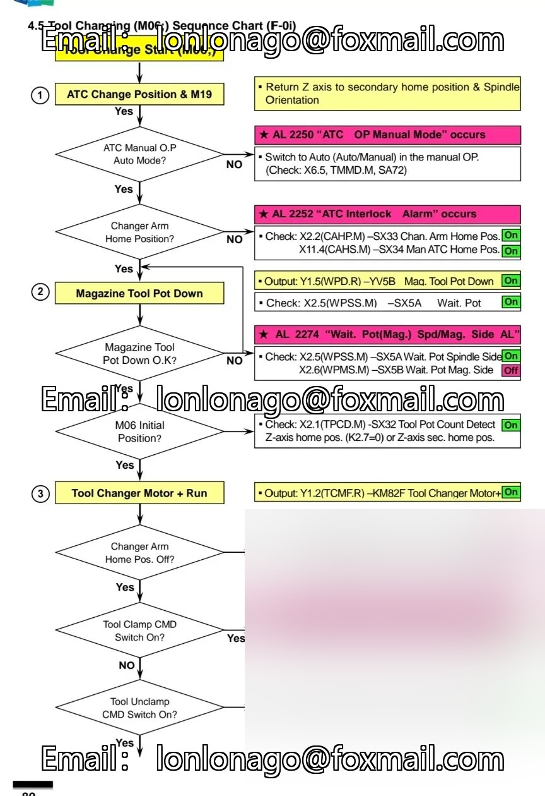
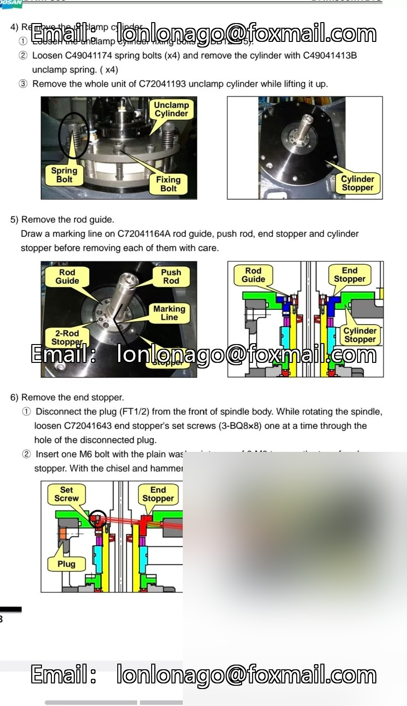
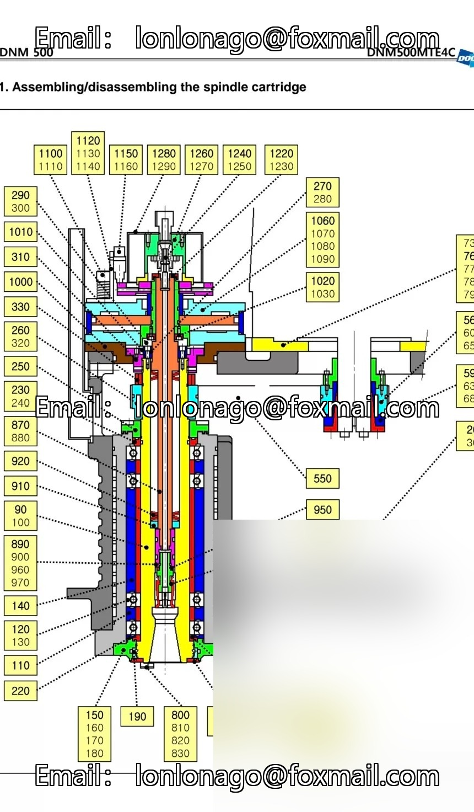

# Doosan Infracore DNM 500 vertical type

## Body

Doosan Infracore DNM 500 vertical machining center (VMC) maintenance manual
100 pages
Contents cover detailed processes including daily maintenance, fault troubleshooting, tool replacement, and spindle component disassembly, accompanied by clear diagrams and operation guides.
Applicable to technical personnel and maintenance personnel for DNM 500 series machining centers.
refunds upon sale.

1744

The Doosan (Doosan Infracore) DNM 500-type vertical machining center maintenance manual consists of 100 pages covering daily maintenance, fault investigation, tool changing and spindle component disassembly with clear diagrams and operation guidance.

<!-- AI_ENRICHED -->

## Images

## Payment

Here is a pay link on Stripe ( https://buy.stripe.com/3cs8yP7sY87d0vu9AB ). Please contact me lonlonago@foxmail.com after funding $89, and I will send you a complete data files , thank you!

